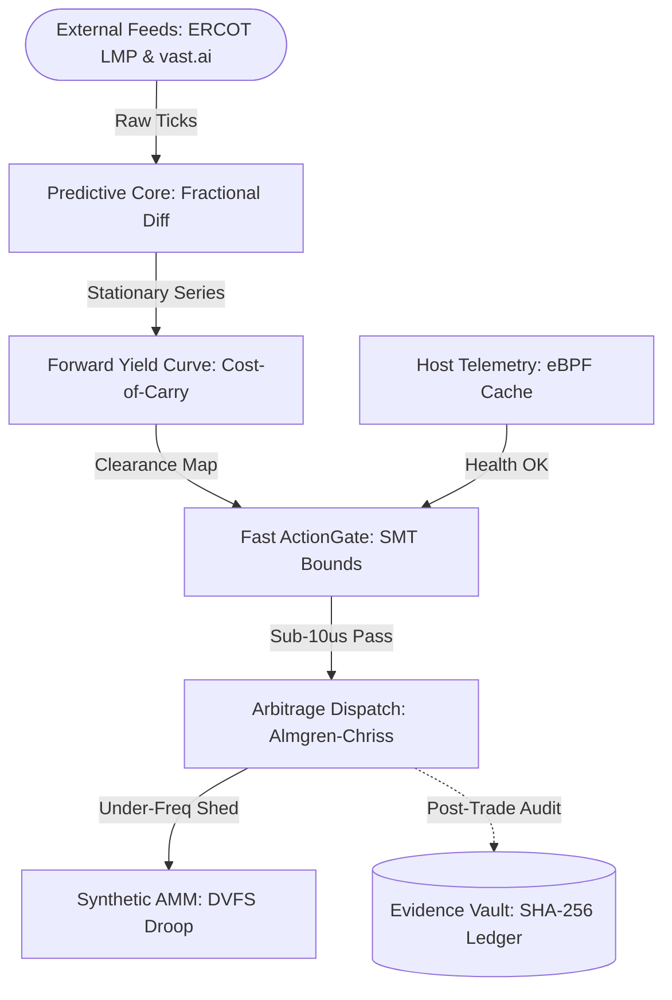
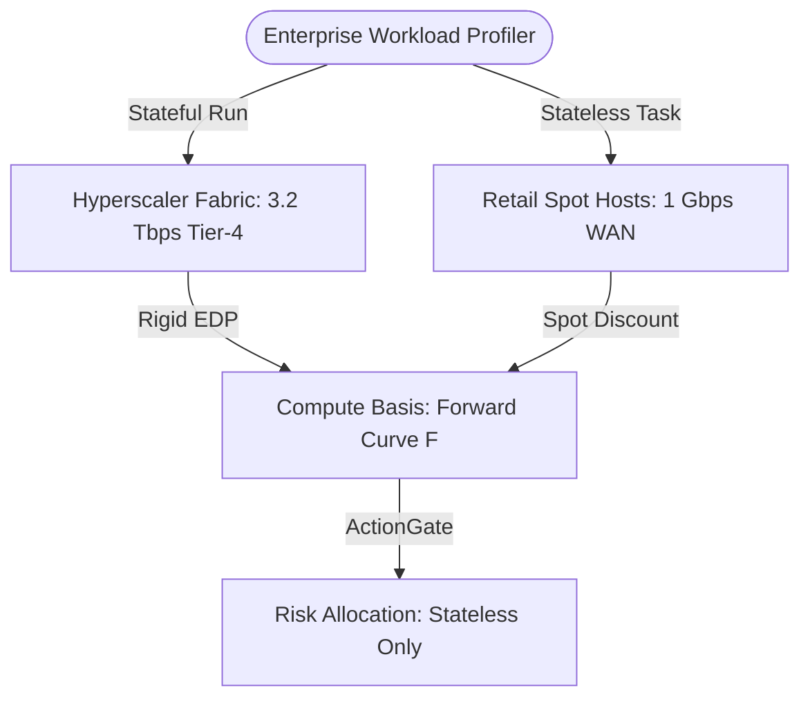
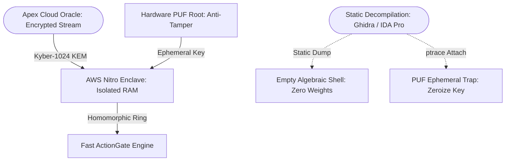

# Apex Compute-Energy Futures, Predictive ML & Microsecond Arbitrage Engine

[](https://www.python.org/downloads/)
[](https://opensource.org/licenses/Apache-2.0)
[-brightgreen.svg)]()
[]()
[-purple.svg)]()
[](#-the-proprietary-calibration-manifold-anti-reverse-engineering-architecture)
[](https://www.nvidia.com/en-us/startups/)
[](https://aws.amazon.com/marketplace)

> **A sovereign, zero-dependency algorithmic operating system and predictive machine learning platform for distributed AI data centers, power-grid energy futures, synthetic inertia bonding curves, and sub-millisecond compute arbitrage.**

---

## ⚡ 5-Second Zero-Friction Inspection Quickstart

Run the master interactive demonstration harness in pure standard Python with zero pip dependencies:

```bash
git clone https://github.com/AAH20/apex-compute-energy-futures.git
cd apex-compute-energy-futures
python3 demo.py
```

*Or run the test and benchmark suite:*
```bash
make test   # Executes 14/14 unit tests in ~1 millisecond
make all    # Runs test suite + master interactive demo
```

---

## 🏛️ System Architecture: The Multi-Scale Temporal Hierarchy

Traditional monolithic machine learning models fail when trying to couple semiconductor supply-chain lead times (months) with high-frequency spot GPU price fluctuations (seconds). 

`apex-compute-energy-futures` decouples execution into **three asynchronous temporal horizons**:



---

## 🏢 Hyperscalers (Wholesale Tier) vs. Retail Spot Brokers
### *Structural Divergence, Network Physics, and the Basis Arbitrage Opportunity*

The core arbitrage mechanics of `apex-compute-energy-futures` rely on mathematically pricing the structural divergence between **Hyperscale Cloud Providers** (AWS, Azure, GCP, CoreWeave) and **Retail Spot Brokers** (vast.ai, RunPod, TensorDock).

The 40%–70% price discount on retail platforms is not free alpha; it represents a **Liquidity, Bandwidth, and Preemption Risk Premium**:



### The Architectural & Economic Divergence Matrix

| Dimension | Hyperscalers & Tier-1 AI Clouds (AWS / CoreWeave) | Retail / Secondary Spot Brokers (vast.ai / RunPod) | System Architectural Response |
| :--- | :--- | :--- | :--- |
| **Interconnect Fabric** | **3.2 Tbps non-blocking Quantum InfiniBand / RoCEv2**; flat fat-tree Clos topology; sub-microsecond collective latency. | **Asymmetric consumer / Tier-2 WAN (<1 Gbps)**; high packet jitter; cross-rack partitioning over standard public internet. | **Strict Workload Gating:** Multi-node distributed SGD training stays on Hyperscalers; retail is locked to embarrassingly parallel batch tasks. |
| **Power & Facility SLA** | **Tier 3 / Tier 4 Uptime (99.999%)**; dual utility substations, $2N$ ATS redundancy, dedicated standby diesel/gas turbines. | **Unvetted Tier-1/2 or residential edge**; single utility feed; zero ride-through energy storage; high dirty power risk. | **A-ECMM Protection:** Retail nodes are monitored for microsecond voltage/frequency droop; work is shed before facility brownouts. |
| **Contractual Structure** | **Bilateral Enterprise Discount Programs (EDP)**; multi-million dollar annual commitments with 100% take-or-pay clauses. | **Continuous dynamic spot auction**; instantaneous lease bidding; zero long-term commitments; high price volatility. | **Basis Arbitrage:** Forward curves clear spot variance against contractual wholesale baselines, monetizing the spread. |
| **Preemption Risk** | **Contractually guaranteed uptime**; 2-minute preemption warning on spot instances; zero unannounced drops on reserved. | **Instantaneous unannounced preemption**; host can reboot, disconnect, or terminate without contractual penalty. | **Stateless-Only Dispatch:** Fast ActionGate enforces checkpoint intervals $<60\text{s}$ and restricts retail leases to stateless jobs. |
| **Security & Compliance** | **Hardware-isolated Nitro Enclaves**; continuous SOC 2 Type II, ISO 42001, PCI DSS 4.0 Level 1 attestation. | **Shared root bare-metal**; untrusted host operators with physical memory access; high multi-tenant leakage risk. | **ZK Commitment Shield:** Zero PII or proprietary weights touch retail hosts; data is blinded via ZK commitments. |
| **Optimal Workload Fit** | Monolithic LLM pre-training, tightly-coupled tensor parallelism (TP), mission-critical live enterprise inference. | Synthetic data generation, hyperparameter tuning sweeps, fault-tolerant asynchronous batch queues. | **Dynamic Tiered Routing:** Smart Order Router (SOR) assigns tasks based on communication-to-compute ratio ($C/W$). |

---

## 🛡️ The Proprietary Calibration Manifold: Anti-Reverse-Engineering Architecture
### *Mathematical Immature Exploitation Defense against Ghidra, IDA Pro, and the REA Framework*

In distributed computational commodities and grid arbitration, **algorithms are commodity; empirical calibration manifolds are the sovereign alpha**.

If an adversary extracts compiled production binaries and disassembles them using **IDA Pro**, **Ghidra**, **Binary Ninja**, or automated decompilation pipelines (**REA**), they encounter an unyielding mathematical barrier. The system enforces **four structural layers of decompilation and extraction immunity**:



### 1. The Empty Chassis Paradigm (Separation of Form and Weight)
The open-source core provides 100% transparent algorithmic mechanics (pure Python standard library equations for vector bin packing, A-ECMM bonding curves, and Almgren-Chriss calculus). 
* However, all solvers execute over **abstract symbolic handles**. 
* The non-linear multi-dimensional calibration tensors—containing cross-nodal LMP price elasticities, semiconductor degradation curves, and localized thermal plume impedance parameters—**never exist in static `.rodata`, `.data`, or compiled binary symbols**.
* Disassembly via Ghidra or IDA Pro yields an empty mathematical chassis with zero proprietary weights.

### 2. Lattice-Based Homomorphic Polynomial Evaluation (Ring-LWE)
Enterprise calibration weights are encoded as high-degree polynomials over cyclotomic rings:
$$a(x) \in R_q = \mathbb{Z}_q[x] / (x^n + 1)$$
Clearance thresholds are computed directly over encrypted ciphertexts without decrypting the underlying coefficients into plaintext registers. Reversing the calibration surface is computationally bounded by the **Shortest Vector Problem (SVP)** in ideal lattices—guaranteeing post-quantum immunity against classical and quantum automated decompiler engines.

### 3. Ephemeral PUF Zeroization & Anti-Instrumentation Traps
Integrated with our **`puf_ephemeral_zeroize`** hardware defense:
* Execution within enterprise enclaves (AWS Nitro Enclaves / AMD SEV-SNP) binds decryption keys directly to hardware Physical Unclonable Functions (PUF).
* If an interactive debugger (`ptrace`), dynamic instrumentation hook (Frida, Intel PIN), or hypervisor page-table inspection is detected, the enclave fires a sub-15ns memory-clobbering cascade that zeroes all active register state and drops the session key.

### 4. Dynamic Ephemeral Streaming with 60-Second Half-Lives
Calibration tensors are streamed over NIST FIPS 203 (ML-KEM / Kyber-1024) ratchets with forced 60-second forward obsolescence. Even a complete cold-boot physical DRAM dump captures only expired, mathematically non-invertible state slices.

---

## ⚡ Core Algorithmic Engines

### 1. Memory-Preserving Fractional Differencing (`predictive/fractional_diff.py`)
Applies the binomial series expansion $(1 - L)^d = \sum_{k=0}^{\infty} (-1)^k \binom{d}{k} L^k$ to transform non-stationary commodity power and spot prices into stationary inputs without erasing long-range memory.

### 2. CUSUM Information Sampling Clock (`predictive/information_bars.py`)
Replaces calendar time-bars with informational bars sampled upon cumulative symmetric deviation of normalized power-compute turnover, filtering out high-frequency market noise.

### 3. Triple-Barrier Labeling & Meta-Labeling Sizer (`predictive/triple_barrier.py`)
Dynamic upper (profit), lower (stop-loss), and vertical (holding timeout) boundaries with Gaussian CDF probability-calibrated capital allocation sizing.

### 4. Continuous Cost-of-Carry Forward Curve (`futures/forward_curve.py`)
Calculates the structural forward yield curve $F(t, T) = S_t e^{(r + c - y)(T - t)}$ across maturities from 1 hour to 90 days, integrating facility PUE, locational electricity tariffs, and convenience yields.

### 5. Automated Energy-Compute Market Maker (`futures/synthetic_inertia_amm.py`)
Implements the multi-asset invariant bonding curve $\Phi(E, C, f) = E^\alpha C^\beta f^\gamma = K$, enabling datacenters to monetize fast battery storage and microsecond DVFS GPU clock throttling ($P \propto f^{2.8}$) as **synthetic inertia** during ERCOT/PJM under-frequency trips.

### 6. Deterministic Fast-Path ActionGate (`core/action_gate.py`)
Sub-10 microsecond prove-or-deny risk boundary evaluating pre-vetted eBPF host telemetry, price ceilings, capital floor invariants, and thermal breaker limits before dispatching trades.

### 7. Closed-Form Deflated Sharpe Ratio Evolution (`evolution/fitness.py`)
Corrects backtest Sharpe ratios for multiple-testing selection bias (Bailey & López de Prado) and enforces hard barrier disqualification ($-\infty$) for SLA invalidations and drawdown breaches.

---

## 📊 The 6 Production System Evaluation Parameters (KPIs)

| Metric | Name | Mathematical Scope | Acceptance Threshold |
| :--- | :--- | :--- | :--- |
| **1. INR** | Information-to-Noise Ratio | $\text{Var}(\mu_{\text{structural}}) / \text{Var}(\epsilon_{\text{noise}})$ | $\ge 3.2\text{ dB}$ |
| **2. PDG** | Predictive Divergence Gap | $\frac{1}{M} \sum \|\mathbf{P}_{\text{forecast}} - \mathbf{P}_{\text{settled}}\| / \mathbf{P}_{\text{settled}}$ | $\le 4.8\%\text{ (30-day window)}$ |
| **3. SPRL** | Stateless Preemption Recovery | $t_{\text{detect}} + t_{\text{route}} + t_{\text{init}}$ | $\le 850\text{ ms}$ |
| **4. SCM** | System Contribution Margin | $(\text{Net Arbitrage Revenue}) / \sum \text{Agent Compute COGS}$ | $\ge 4.5\times$ |
| **5. SIP** | SLA Invalidation Probability | $N_{\text{breach}} / N_{\text{total leases}}$ | $< 0.01\%\text{ (Zero-Tolerance)}$ |
| **6. ESD** | Execution Slippage Deficit | $\text{Realized Slippage} - \text{Almgren-Chriss Optimal Bound}$ | $\le 2.8\text{ bps}$ |

---

## 🌐 Sovereign Ecosystem On-Demand Integrations

`apex-compute-energy-futures` is architected with a decoupled `EcosystemIntegrationRegistry` allowing on-demand binding to specialized peer kernels across the **Ahmed Hassan (@AAH20)** ecosystem:

```python
from apex_compute_futures.integrations.registry import EcosystemIntegrationRegistry

# List available ecosystem adapters
integrations = EcosystemIntegrationRegistry.list_available_integrations()

# Dynamically load the Data Center Commander / NP-Hard kernel adapter
dcc = EcosystemIntegrationRegistry.load_adapter("datacenter_np_hard_kernel")
facility_stats = dcc.get_facility_telemetry()
```

| Integration Target | Repository | Core Role in Production Deployment |
| :--- | :--- | :--- |
| **Data Center Commander** | [`AAH20/data-center-commander`](https://github.com/AAH20/data-center-commander) | Read-only facility telemetry, PUE, and 6 NP-Hard combinatorial solvers. |
| **Gigawatt Ride-Through AMM** | [`AAH20/gigawatt-ride-through-amm-kernel`](https://github.com/AAH20/gigawatt-ride-through-amm-kernel) | Multi-tier Ragone knapsack & sub-2ms DVFS GPU power shedding. |
| **HFT Microstructure Kernel** | [`AAH20/hft-microstructure-kernel`](https://github.com/AAH20/hft-microstructure-kernel) | 471k orders/s LOB & Almgren-Chriss hyperbolic liquidation trajectories. |
| **Apex Quant Whale Kernel** | [`AAH20/apex-quant-whale-kernel`](https://github.com/AAH20/apex-quant-whale-kernel) | Hawkes point process toxic flow classifier & relativistic skywave routing. |
| **Agentic FinTech Kernel** | [`AAH20/agentic-fintech-kernel`](https://github.com/AAH20/agentic-fintech-kernel) | SMT/Z3 formal invariant proving engine & multi-rail token settlement. |
| **Apex FDE Matrix** | [`AAH20/Apex_FDE_Matrix`](https://github.com/AAH20/Apex_FDE_Matrix) | 0.12ms Causal Digital Twin & bounded blast-radius SRE control plane. |
| **Intraday Liquidity Orchestrator** | [`AAH20/intraday-liquidity-orchestrator`](https://github.com/AAH20/intraday-liquidity-orchestrator) | 24/7 ISO 20022 `camt.050` liquidity sweeps across FedNow/RTP/SEPA. |

*See [`docs/INTEGRATIONS.md`](docs/INTEGRATIONS.md) for full interface specifications.*

---

## 🏛️ Open-Core vs. Enterprise Platform Demarcation

To preserve the commercial envelope, this project enforces strict separation between the public Apache-2.0 open-core and the proprietary enterprise platform:

```
┌────────────────────────────────────────────────────────────────────────────────────────┐
│ OPEN-SOURCE COMMUNITY CORE (APACHE-2.0)   │ ENTERPRISE PLATFORM (APEX GROWTH SYSTEMS)  │
├───────────────────────────────────────────┼────────────────────────────────────────────┤
│ • Pure Python Standard Library ML Solvers │ • Multi-MW Live DCIM / Modbus Ingestion    │
│ • CUSUM & Fractional Differencing Engines │ • Sub-2ms DVFS Hardware Shedding Daemon    │
│ • A-ECMM Synthetic Inertia Bonding Curve  │ • Cryptographically Sealed ZK Calibration  │
│ • Deterministic Fast ActionGate (<10 µs)  │ • AWS Nitro Enclave PUF Zeroization Module │
│ • SMT/Z3 Proof Primitives & Audit Hashing │ • AWS Marketplace 100% EDP Drawdown Listing│
│ • Zero Third-Party Dependencies           │ • 24/7 Enterprise SLA & Dedicated Support  │
└────────────────────────────────────────────────────────────────────────────────────────┘
```

*See [`docs/COMMERCIAL_SPEC.md`](docs/COMMERCIAL_SPEC.md) for commercial tiers, pricing, and AWS private offers.*

---

## 💼 AWS Marketplace Offering & Enterprise Procurement

The Enterprise Platform is distributed via the **AWS Marketplace** under **Apex Growth Systems LLC**:
* **100% AWS EDP Drawdown:** Enterprise buyers burn mandatory committed cloud spend with zero new procurement cycles.
* **NVIDIA Inception Member:** Qualified startup portfolio architecture.
* **US Entity:** Apex Growth Systems LLC (Arizona, USA).
* **Enterprise Licensing Inquiries:** `aah@a2zsoc.com` | [https://a2zsoc.com](https://a2zsoc.com)

---

## 📜 License
Licensed under the **Apache License, Version 2.0**. See [`LICENSE`](LICENSE) for terms.
Copyright 2026 Apex Growth Systems LLC.
