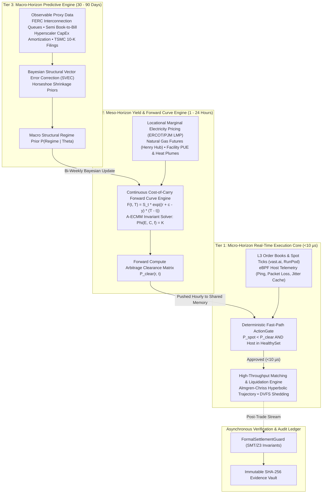

# Technical Architecture & Formal Specifications

`apex-compute-energy-futures` is an autonomous computational engine designed to resolve the multi-scale coupling problem between semiconductor manufacturing forecasts, power grid economics, and high-frequency GPU spot market execution.

---

## 1. The Multi-Scale Temporal Hierarchy

To eliminate the catastrophic temporal impedance mismatch endemic to monolithic models, execution is partitioned into three strictly decoupled horizons communicating asynchronously:

---

## 2. Core Mathematical Formulations

### A. Memory-Preserving Stationarity (Fractional Differencing)
Raw commodity energy and compute spot rates are non-stationary. Integer differencing ($d = 1$) erases long-memory autocorrelation. The pipeline applies fractional differencing via binomial expanding series:

$$(1 - L)^d = \sum_{k=0}^{\infty} (-1)^k \binom{d}{k} L^k = 1 - dL + \frac{d(d - 1)}{2!} L^2 - \frac{d(d - 1)(d - 2)}{3!} L^3 + \dots$$

Weights are generated iteratively without factorial overflow:
$$w_0 = 1, \quad w_k = -w_{k-1} \frac{d - k + 1}{k}$$

### B. Continuous Invariant Energy-Compute AMM (A-ECMM)
The physical co-optimization of battery storage $E$ (MWh), throttling compute capacity $C$ (MW), and grid frequency $f$ (Hz) is governed by:

$$\Phi(E, C, f) = E^\alpha \cdot C^\beta \cdot f^\gamma = K$$

During an under-frequency grid trip event ($\Delta f < 0$), the required compute drop to inject synthetic inertia is governed by the frequency droop elasticity:

$$\Delta C = \frac{\gamma}{\beta} \cdot \frac{C_0}{f_0} \cdot \Delta f \cdot G_{\text{droop}}$$

Shedding is executed via sub-2ms Dynamic Voltage and Frequency Scaling (DVFS), exploiting the cubic power law:
$$P_{\text{compute}} \propto V^2 f_{\text{clk}} \propto f_{\text{clk}}^{2.8}$$

### C. Deflated Sharpe Ratio (DSR) & Evolutionary Selection
Standard backtesting suffers from selection bias under multiple testing. The genetic archetype engine evaluates survival fitness using the closed-form Deflated Sharpe Ratio (Bailey & López de Prado):

$$\text{DSR} = \text{SR} \cdot \sqrt{1 - \gamma_3 \cdot \text{SR} + \frac{\gamma_4 - 1}{4} \cdot \text{SR}^2} \cdot \left(1 - \frac{\gamma_{\text{Euler}}}{\sqrt{2 \ln N}}\right)$$

Where:
* $\text{SR}$: Realized annualized Sharpe ratio of the archetype.
* $\gamma_3, \gamma_4$: Realized skewness and kurtosis of arbitrage returns.
* $N$: Number of independent genetic variations tested.

---

## 3. The 6 Closed-Form System Evaluation Parameters (KPIs)

1. **Information-to-Noise Ratio (INR):**
   $$\text{INR} = \frac{\sigma^2_{\text{macro regime}}(\Delta P)}{\sigma^2_{\text{residual tick noise}}(\epsilon)} \ge 3.2\text{ dB}$$
2. **Predictive Divergence Gap (PDG):**
   $$\text{PDG} = \frac{1}{M} \sum_{i=1}^M \frac{|\mathbf{P}_{\text{forecast}}(r, t_i) - \mathbf{P}_{\text{settled}}(r, t_i)|}{\mathbf{P}_{\text{settled}}(r, t_i)} \le 4.8\%$$
3. **Stateless Preemption Recovery Latency (SPRL):**
   $$T_{\text{recovery}} = t_{\text{eBPF close}} + t_{\text{KKT re-route}} + t_{\text{standby handshake}} \le 850\text{ ms}$$
4. **System Contribution Margin (SCM):**
   $$\text{SCM} = \frac{\text{Net Arbitrage Revenue} - \text{Execution Fees}}{\sum \text{Agent Compute COGS}} \ge 4.5\times$$
5. **SLA Invalidation Probability (SIP):**
   $$\text{SIP} = \frac{N_{\text{breach}}}{N_{\text{total leases}}} \le 0.01\% \quad (\text{Strict Zero-Tolerance})$$
6. **Execution Slippage Deficit (ESD):**
   $$\text{ESD} = \text{Realized Slippage} - \text{Almgren-Chriss Optimal Bound} \le 2.8\text{ bps}$$
