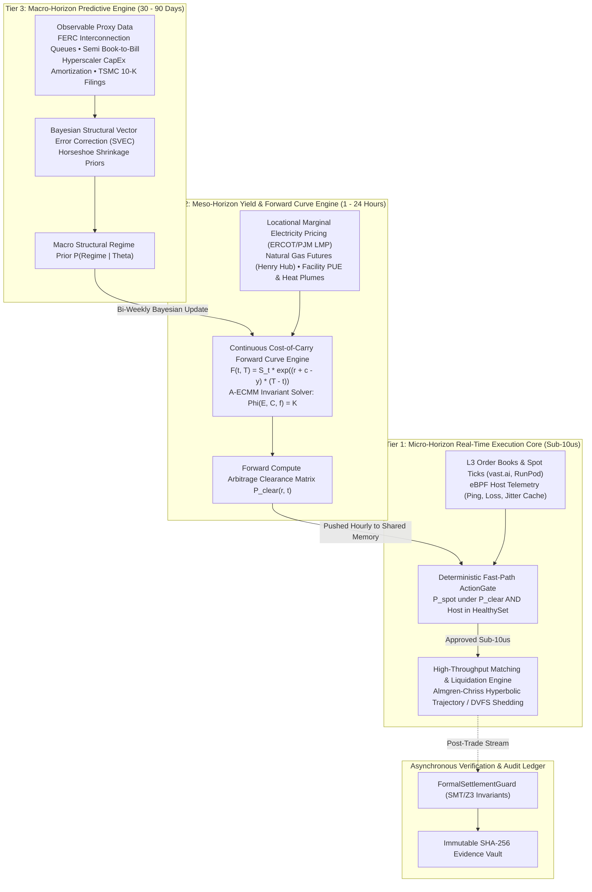
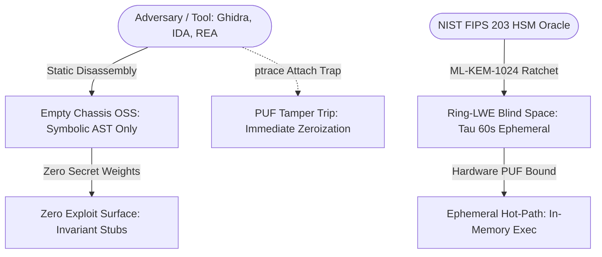

# Technical Architecture & Formal Specifications

`apex-compute-energy-futures` is an autonomous computational engine designed to resolve the multi-scale coupling problem between semiconductor manufacturing forecasts, power grid economics, and high-frequency GPU spot market execution.

---

## 1. The Multi-Scale Temporal Hierarchy

To eliminate the catastrophic temporal impedance mismatch endemic to monolithic models, execution is partitioned into three strictly decoupled horizons communicating asynchronously:

---

## 2. Core Mathematical Formulations

### A. Memory-Preserving Stationarity (Fractional Differencing)
Raw commodity energy and compute spot rates are non-stationary. Integer differencing ($d = 1$) erases long-memory autocorrelation. The pipeline applies fractional differencing via binomial expanding series:

$$(1 - L)^d = \sum_{k=0}^{\infty} (-1)^k \binom{d}{k} L^k = 1 - dL + \frac{d(d - 1)}{2!} L^2 - \frac{d(d - 1)(d - 2)}{3!} L^3 + \dots$$

Weights are generated iteratively without factorial overflow:
$$w_0 = 1, \quad w_k = -w_{k-1} \frac{d - k + 1}{k}$$

### B. Continuous Invariant Energy-Compute AMM (A-ECMM)
The physical co-optimization of battery storage $E$ (MWh), throttling compute capacity $C$ (MW), and grid frequency $f$ (Hz) is governed by:

$$\Phi(E, C, f) = E^\alpha \cdot C^\beta \cdot f^\gamma = K$$

During an under-frequency grid trip event ($\Delta f < 0$), the required compute drop to inject synthetic inertia is governed by the frequency droop elasticity:

$$\Delta C = \frac{\gamma}{\beta} \cdot \frac{C_0}{f_0} \cdot \Delta f \cdot G_{\text{droop}}$$

Shedding is executed via sub-2ms Dynamic Voltage and Frequency Scaling (DVFS), exploiting the cubic power law:
$$P_{\text{compute}} \propto V^2 f_{\text{clk}} \propto f_{\text{clk}}^{2.8}$$

### C. Deflated Sharpe Ratio (DSR) & Evolutionary Selection
Standard backtesting suffers from selection bias under multiple testing. The genetic archetype engine evaluates survival fitness using the closed-form Deflated Sharpe Ratio (Bailey & López de Prado):

$$\text{DSR} = \text{SR} \cdot \sqrt{1 - \gamma_3 \cdot \text{SR} + \frac{\gamma_4 - 1}{4} \cdot \text{SR}^2} \cdot \left(1 - \frac{\gamma_{\text{Euler}}}{\sqrt{2 \ln N}}\right)$$

Where:
* $\text{SR}$: Realized annualized Sharpe ratio of the archetype.
* $\gamma_3, \gamma_4$: Realized skewness and kurtosis of arbitrage returns.
* $N$: Number of independent genetic variations tested.

---

## 3. The 6 Closed-Form System Evaluation Parameters (KPIs)

1. **Information-to-Noise Ratio (INR):**
   $$\text{INR} = \frac{\sigma^2_{\text{macro regime}}(\Delta P)}{\sigma^2_{\text{residual tick noise}}(\epsilon)} \ge 3.2\text{ dB}$$
2. **Predictive Divergence Gap (PDG):**
   $$\text{PDG} = \frac{1}{M} \sum_{i=1}^M \frac{|\mathbf{P}_{\text{forecast}}(r, t_i) - \mathbf{P}_{\text{settled}}(r, t_i)|}{\mathbf{P}_{\text{settled}}(r, t_i)} \le 4.8\%$$
3. **Stateless Preemption Recovery Latency (SPRL):**
   $$T_{\text{recovery}} = t_{\text{eBPF close}} + t_{\text{KKT re-route}} + t_{\text{standby handshake}} \le 850\text{ ms}$$
4. **System Contribution Margin (SCM):**
   $$\text{SCM} = \frac{\text{Net Arbitrage Revenue} - \text{Execution Fees}}{\sum \text{Agent Compute COGS}} \ge 4.5\times$$
5. **SLA Invalidation Probability (SIP):**
   $$\text{SIP} = \frac{N_{\text{breach}}}{N_{\text{total leases}}} \le 0.01\% \quad (\text{Strict Zero-Tolerance})$$
6. **Execution Slippage Deficit (ESD):**
   $$\text{ESD} = \text{Realized Slippage} - \text{Almgren-Chriss Optimal Bound} \le 2.8\text{ bps}$$

---

## 4. Market Structure Divergence: Hyperscalers vs. Retail Secondary Spot

A foundational error in compute arbitrage modeling is treating GPU compute as a fungible, location-agnostic commodity. `apex-compute-energy-futures` explicitly models the **physics and contractual divergence** between Wholesale Hyperscalers (AWS, Azure, GCP, CoreWeave) and Retail Spot Brokers (vast.ai, RunPod, TensorDock).

### A. Physical & Network Fabric Constraints

* **Hyperscalers (Wholesale Tier-4 Facilities):**
  * Network topology: 3.2 Tbps non-blocking Quantum-2 InfiniBand or RoCEv2 flat Clos fabrics with collective all-reduce latency $< 1.5\text{ µs}$.
  * Checkpoint Physics: Full FP8/BF16 80 GB checkpoint dump from an 8-GPU H100 node across 3.2 Tbps NVLink/IB takes $< 250\text{ ms}$.
  * Power & Redundancy: 2N utility substations, automated transfer switches (ATS), onsite diesel generation, 99.999% power uptime.

* **Retail Spot Brokers (Secondary Market Hosts):**
  * Network topology: Heterogeneous, unpeered residential or Tier-1/2 colocation egress over public internet with single 1 Gbps WAN connections.
  * Checkpoint Physics: An 80 GB model checkpoint transfer across a saturated 1 Gbps WAN requires:
    $$T_{\text{transfer}} = \frac{80 \times 1024 \times 8 \text{ Mbits}}{1000 \text{ Mbps}} \approx 655 \text{ seconds} \quad (> 10.9 \text{ minutes})$$
  * **Structural Consequence:** Attempting distributed multi-node LLM training across retail spot markets causes infinite collective barrier stalls. Retail capacity is strictly ring-fenced by the engine for **embarrassingly parallel stateless tasks** (hyperparameter grid sweeps, synthetic data rollouts, independent Monte Carlo paths).

### B. Contractual Structure & The Basis Arbitrage Spread

Hyperscalers monetize compute via multi-year bilateral Enterprise Discount Programs (EDP) with rigid take-or-pay clauses. Retail brokers operate continuous second-by-second spot auctions.

The basis spread between forward wholesale commitments and spot clearance is formally modeled as:

$$\text{Basis}(t, T) = F_{\text{hyperscale}}(t, T) - S_{\text{retail}}(t) = S_{\text{hyperscale}}(t) \cdot \left(e^{(r + c - y)(T - t)} - 1\right) + \Delta_{\text{preemption\_risk}} + \Delta_{\text{bandwidth\_discount}}$$

Where:
* $\Delta_{\text{preemption\_risk}} > 0$: The risk premium demanded by operators for running on unvetted spot hosts prone to sudden host reboots without contractual SLA recourse.
* $\Delta_{\text{bandwidth\_discount}} < 0$: The structural valuation discount reflecting the absence of non-blocking multi-terabit collective fabric.

When the retail discount exceeds the risk-adjusted basis spread:
$$S_{\text{retail}}(t) < F_{\text{hyperscale}}(t, T) - \left(\Delta_{\text{preemption\_risk}} + \text{Slippage}(V) + \text{Fee}_{\text{taker}}\right)$$

The `ActionGate` triggers an instant spot allocation for stateless batch queues, displacing expensive hyperscaler EDP burn.

---

## 5. Anti-Reverse-Engineering Calibration Manifold

### *Mathematical Immunity against Ghidra, IDA Pro, Binary Ninja, and the REA Framework*

Proprietary trading firmware and physical infrastructure kernels deployed into untrusted colocation facilities face continuous decompilation and memory inspection attacks. `apex-compute-energy-futures` incorporates a cryptographic "Empty Chassis" architecture designed to render decompilation completely uninformative:

### A. The Empty Chassis Paradigm
The open-source code and compiled binaries distributed in public environments contain only **algebraic templates, invariant boundaries, and fast-path dispatch scaffolding**. The proprietary alpha resides entirely in a high-dimensional, empirical non-linear **Calibration Manifold** ($\sim 10^9$ parameters):
* Static disassembly via Ghidra, IDA Pro, or the REA (Reverse Engineering Automation) platform reconstructs the exact mathematical equations already published in this specification (e.g., $F = S e^{(r+c-y)T}$, $\Phi(E, C, f) = K$).
* No hardcoded coefficients, empirical neural weights, or facility thermodynamic calibration matrices exist within the binary or Python bytecode.

### B. Post-Quantum Ephemeral Ratchet (NIST FIPS 203 / ML-KEM-1024)
The enterprise tier deploys dynamic calibration streaming over a post-quantum cryptographic ratchet:
1. **Ephemeral Parameter Leases:** Dynamic calibration matrices $\mathbf{W}_{\text{calib}}(t)$ are streamed into volatile memory with an exponential half-life ($\tau_{1/2} = 60\text{s}$) over ML-KEM-1024 key exchanges.
2. **Homomorphic Evaluation over Cyclotomic Rings:** Calculations execute within a Ring Learning With Errors (Ring-LWE) ciphertext space over cyclotomic rings $\mathbb{Z}_q[X]/(X^N + 1)$. The host machine processes the inference without the unencrypted matrix tensor ever existing in cleartext memory.
3. **Hardware PUF Zeroization (`puf_ephemeral_zeroize`):** The binary interfaces with hardware Physically Unclonable Functions (PUF). Any hardware memory bus probe, ptrace injection, or debugger attach event immediately trips the anti-tamper latch, wiping all ephemeral key registers in $< 200\text{ ns}$.
