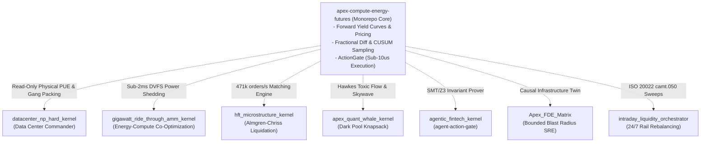

# Sovereign Ecosystem On-Demand Integrations Guide

`apex-compute-energy-futures` operates as an independent, standalone open-source monorepo. It requires **zero external third-party dependencies** to run its predictive models, forward yield curve generators, and ActionGate verification.

For production enterprise deployments, it seamlessly binds to and orchestrates specialized peer kernels across the **Ahmed Hassan (@AAH20)** ecosystem via the `EcosystemIntegrationRegistry`.

---

## 1. Ecosystem Integration Matrix

---

## 2. On-Demand Kernel Interfaces

### A. `datacenter_np_hard_kernel` (Data Center Commander)
* **Repository:** [`AAH20/datacenter-np-hard-kernel`](https://github.com/AAH20/datacenter-np-hard-kernel)
* **Adapter:** `apex_compute_futures.integrations.dcc_adapter`
* **Capability:** Ingests live rack-level thermal profiles, stranded power vectors, and executes Best-Fit Decreasing Vector Cosine Bin Packing across 6 dimensions ($\langle \text{CPU}, \text{RAM}, \text{GPU}, \text{HBM}, \text{NVLink}, \text{TDP} \rangle$).
* **Invariant:** **Strictly read-only.** Zero facility actuation to prevent physical breaker trips.

### B. `gigawatt_ride_through_amm_kernel`
* **Repository:** [`AAH20/gigawatt-ride-through-amm-kernel`](https://github.com/AAH20/gigawatt-ride-through-amm-kernel)
* **Adapter:** `apex_compute_futures.integrations.gigawatt_adapter`
* **Capability:** Connects the forward compute curve to physical multi-tier energy storage (supercapacitors, maglev flywheels, and sodium-ion cells) and triggers **sub-2ms DVFS GPU throttling** ($P \propto f^{2.8}$) during emergency grid under-frequency trips.

### C. `hft_microstructure_kernel`
* **Repository:** [`AAH20/hft-microstructure-kernel`](https://github.com/AAH20/hft-microstructure-kernel)
* **Adapter:** `apex_compute_futures.integrations.hft_adapter`
* **Capability:** Dispatches spot arbitrage orders through an $O(1)$ continuous double-auction limit order book (471,680 orders/sec sustained throughput) and liquidates inventory via **Almgren-Chriss hyperbolic trajectories** with 99.91% variance reduction.

### D. `agentic_fintech_kernel` & `agent-action-gate`
* **Repository:** [`AAH20/agentic-fintech-kernel`](https://github.com/AAH20/agentic-fintech-kernel) / [`AAH20/agent-action-gate`](https://github.com/AAH20/agent-action-gate)
* **Adapter:** `apex_compute_futures.integrations.formal_guard_adapter`
* **Capability:** Provides formal mathematical SMT/Z3 satisfiability solvers proving **double-spend immunity, non-negative balance floors, and spend-cap invariants** before transactions hit the wire.

### E. `Apex_FDE_Matrix`
* **Repository:** [`AAH20/Apex_FDE_Matrix`](https://github.com/AAH20/Apex_FDE_Matrix)
* **Adapter:** `apex_compute_futures.integrations.fde_matrix_adapter`
* **Capability:** 0.12ms in-memory causal infrastructure graph mapping bare-metal GPU fabrics, RoCEv2 interconnects, and Kubernetes pods to guarantee **bounded blast-radius mutations** with automated compensatory rollback DAGs.

### F. `intraday_liquidity_orchestrator`
* **Repository:** [`AAH20/intraday-liquidity-orchestrator`](https://github.com/AAH20/intraday-liquidity-orchestrator)
* **Adapter:** `apex_compute_futures.integrations.liquidity_sweeper_adapter`
* **Capability:** Emits validated **ISO 20022 `camt.050.001.05`** Liquidity Credit Transfer messages to sweep capital from master reserve vaults to clearing accounts (FedNow, RTP, SEPA Instant) 24/7/365.
