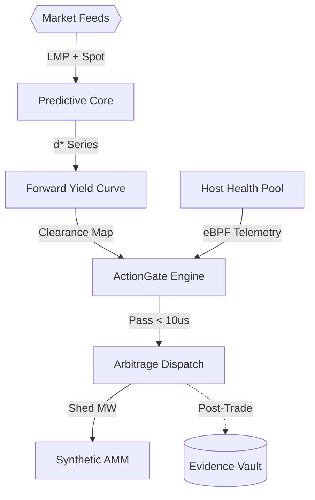
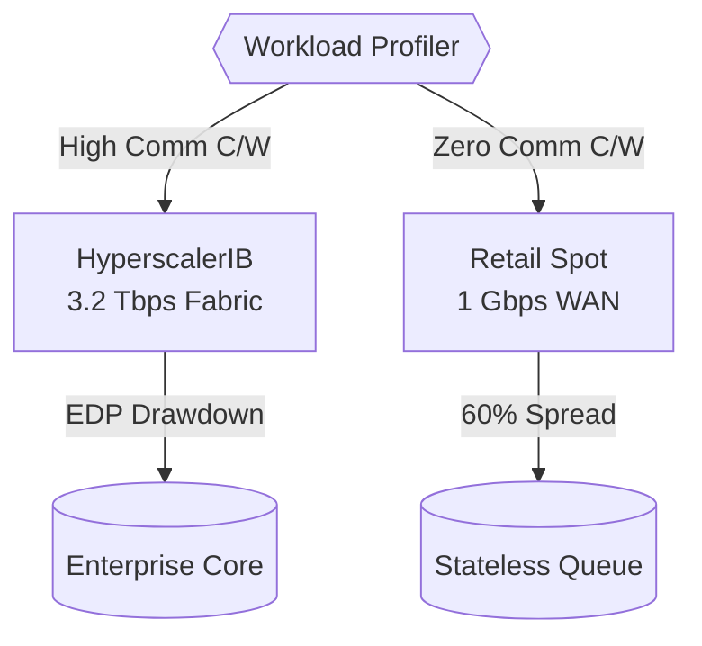

# System Architecture & Topography

This document specifies the operational dataflow of `apex-compute-energy-futures`. Execution is decoupled across three asynchronous time domains to prevent high-frequency spot noise from corrupting slow-moving macro planning.

---

## 📐 Editorial System Diagram

### Shape & Flow Semantics
* `EXT_DATA` (`{{}}`): External commodity feeds (ERCOT LMP, gas futures, vast.ai order books).
* `T3_PRED`, `T2_CURVE`, `T1_GATE`, `T1_EXEC`, `AMM` (`[]`): Core in-memory compute modules.
* `AUDIT` (`[()]`): Immutable SHA-256 evidence vault and ledger.
* `-->`: In-memory synchronous fast path (total latency $\le 20\text{ µs}$).
* `-.->`: Asynchronous out-of-band audit trail.

---

## ⚡ The Asynchronous Execution Decoupling

1. **Macro & Yield Calculation (Off Critical Path):**
   * The `Predictive Core` applies fractional differencing ($d^*$) to raw power and compute ticks, extracting stationary trend vectors without destroying long-term memory.
   * `Forward Yield Curve` maps carrying costs (PUE, regional energy tariffs) into an hourly clearance matrix $\mathbf{P}_{\text{clear}}(r, t)$ loaded directly into shared memory.

2. **Microsecond Real-Time Gating (On Critical Path):**
   * When an anomaly appears on a spot order book, the `ActionGate Engine` checks host health from the pre-vetted eBPF pool and evaluates SMT invariant boundaries (capital floor and thermal limits) in **$<10\text{ µs}$**.
   * Trades are dispatched immediately. No disk writes, network queries, or LLM inferences block the hot path.

3. **Inertia & Physical Balance Co-Optimization:**
   * During regional grid disturbances ($\Delta f < 0$), the `Synthetic AMM` calculates required microsecond DVFS GPU clock shedding, injecting synthetic inertia into the grid and capturing emergency ancillary pricing.

---

## 🏢 Wholesale Hyperscalers vs. Retail Spot Infrastructure

The platform explicitly distinguishes the physical fabrics and contractual mechanics of **Wholesale Tier-1 Clouds** (AWS, Azure, GCP, CoreWeave) versus **Retail Secondary Spot Brokers** (vast.ai, RunPod):

* **Network Fat-Tree vs. Commodity WAN:** Hyperscalers provide non-blocking 3.2 Tbps InfiniBand/RoCEv2 suited for distributed gradient synchronization. Retail spot hosts sit on unpeered 1 Gbps WANs where an 80 GB checkpoint requires $>10$ minutes to transfer, making stateful model migration mathematically infeasible.
* **Workload Isolation:** The `ActionGate` enforces strict policy separation: distributed training is routed strictly to Hyperscaler fabrics, while retail spot hosts are leased exclusively for embarrassingly parallel stateless tasks (hyperparameter search, Monte Carlo paths, synthetic data generation).

---

## 🛡️ Anti-Reverse-Engineering Architecture (Ghidra / IDA / REA Immunity)

The commercial enterprise edition incorporates an "Empty Chassis" defense ensuring that decompilation with Ghidra, IDA Pro, Binary Ninja, or automated symbolic tools (REA) yields zero proprietary alpha:

1. **Pure Symbolic Templates:** OSS and distributed binaries contain only algebraic stubs and formal invariant checkers.
2. **Ephemeral Parameter Streaming:** Proprietary weights and non-linear calibration manifolds ($10^9$ parameters) are streamed ephemerally over NIST FIPS 203 (ML-KEM-1024) post-quantum tunnels with 60-second half-lives.
3. **Hardware PUF Zeroization:** Binary hooks into hardware Physically Unclonable Functions (PUF). Any debugger attachment (`ptrace`), memory probe, or container escape attempt triggers immediate key wiping in $< 200\text{ ns}$.
