# UML Class Diagram

This diagram specifies the core object model and relationship boundaries of the `apex-compute-energy-futures` monorepo.

---

```mermaid
classDiagram
    class ActionGate {
        +float max_single_trade_usd
        +float max_daily_budget_usd
        +FormalInvariantVerifier verifier
        +Dict~str, HostNode~ healthy_hosts_pool
        +register_healthy_host(HostNode host) void
        +evaluate_arbitrage_trade(ArbitrageQuote quote, str ip, float balance, float rack_kw) ActionGateDecision
    }

    class FormalInvariantVerifier {
        +float reserve_floor_usd
        +float max_rack_kw
        +Set~str~ allocated_instance_ids
        +verify_capital_conservation(float balance, float outflow) Tuple~bool, str~
        +verify_thermal_power_boundary(float current_kw, float add_kw) Tuple~bool, str~
        +generate_cryptographic_audit_hash(str action, str target, float amount, bool passed) str
    }

    class FractionalDifferentiator {
        +get_weights(float d, int size) List~float~
        +transform(List~float~ series, float d) List~float~
        +memory_retention_ratio(List~float~ orig, List~float~ diff) float
        +find_optimal_d(List~float~ series) float
    }

    class ComputeForwardCurve {
        +str region
        +float base_spot_rate
        +float facility_pue
        +price_forward(float maturity_hours, SLATier sla) ForwardCurvePoint
        +generate_full_term_structure() List~ForwardCurvePoint~
    }

    class SyntheticInertiaAMM {
        +AmmPoolState state
        +float alpha
        +float beta
        +float gamma
        +quote_frequency_response(float f_observed, float ancillary_price) InertiaSwapQuote
    }

    class SystemFitnessCalculator {
        +float max_sla_rate
        +float max_dd
        +calculate_deflated_sharpe_ratio(List~float~ returns, int trials) float
        +evaluate_archetype_fitness(List~float~ returns, float sla_rate, float dd) float
    }

    ActionGate --> FormalInvariantVerifier : executes proofs
    ActionGate ..> ComputeForwardCurve : consumes clearance
```

### Architectural Notes:
* Generics are strictly typed using GitHub-native Mermaid syntax (`List~float~`).
* The `ActionGate` holds a direct dependency on `FormalInvariantVerifier`, ensuring mathematical invariants execute on every trade evaluation.
* `FractionalDifferentiator` and `SystemFitnessCalculator` operate as stateless, deterministic mathematical kernels.
