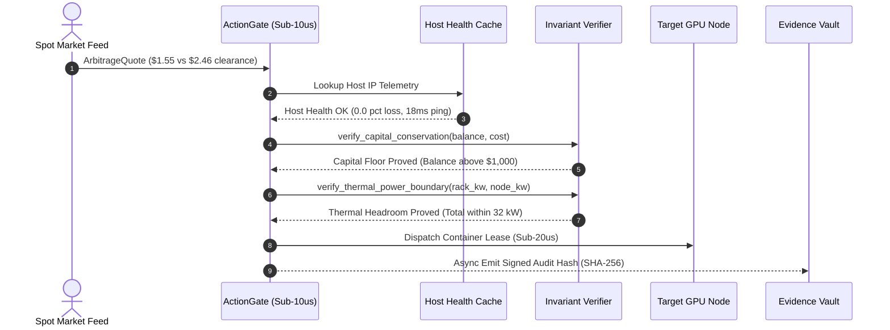
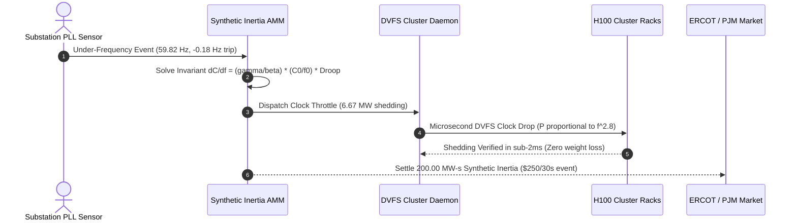
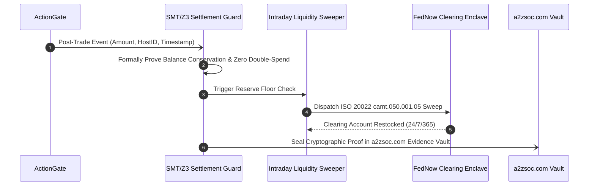

# Execution Sequence Diagrams

This document details the microsecond execution sequences across critical runtime workflows.

---

## 1. Fast-Path Arbitrage Evaluation (Sub-10us)

---

## 2. Emergency Grid Under-Frequency Response (A-ECMM)

---

## 3. Asynchronous Settlement & Liquidity Sweep

