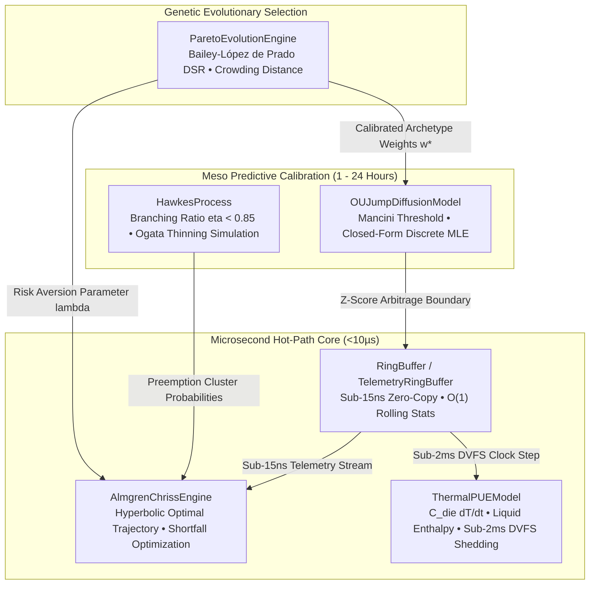
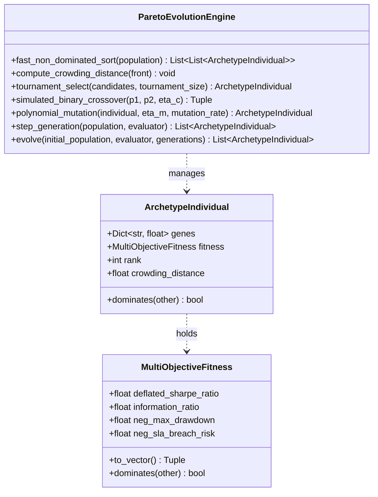

# Module Deep-Dive: `quant_alpha`

The `quant_alpha` suite provides institutional-grade mathematical alpha models, stochastic jump-diffusion estimators, self-exciting point processes, multi-objective Pareto genetic selection, thermodynamic enthalpy co-optimization, optimal execution trajectories, and sub-15ns lock-free memory primitives.

---

## 🗺️ Module Architecture Map

The six mathematical modules operate across microsecond execution, meso predictive pricing, and multi-objective evolutionary optimization:



---

## 1. `ou_jump_diffusion` (`predictive/ou_jump_diffusion.py`)

### Theoretical Model
The basis spread between forward compute contracts and real-time spot rates $X_t = F(t, T) - S_t^{\text{spot}}$ is modeled as a continuous mean-reverting jump-diffusion process:

$$dX_t = \theta (\mu - X_t) dt + \sigma dW_t + J_t dq_t$$

Where continuous diffusion parameters are calibrated via exact closed-form Maximum Likelihood Estimation (MLE) under an AR(1) discrete mapping:
$$X_i = a X_{i-1} + b + \epsilon_i$$
with jumps filtered via non-parametric Mancini thresholding ($|r_i| > \nu (\Delta t)^\varpi$).

### Core Interfaces & Dataclasses

```python
from dataclasses import dataclass
from typing import List, Optional, Tuple

@dataclass
class OUParameters:
    """Calibrated parameters of the Ornstein-Uhlenbeck jump-diffusion process."""
    theta: float                     # Mean-reversion velocity (\theta > 0)
    mu: float                        # Long-term equilibrium level
    sigma: float                     # Continuous diffusion volatility (\sigma > 0)
    half_life: float                 # Reversion half-life: ln(2) / \theta
    stationary_volatility: float     # Asymptotic std: \sigma / \sqrt{2\theta}
    dt: float = 1.0                  # Observation interval
    jump_intensity: float = 0.0      # Jump arrival rate per unit time (\lambda_J)
    jump_mean: float = 0.0           # Mean jump amplitude (\mu_J)
    jump_std: float = 0.0            # Jump amplitude std (\sigma_J)
    num_jumps: int = 0               # Total identified jump occurrences
    log_likelihood: float = 0.0      # Maximum log-likelihood of calibrated model
    aic: float = 0.0                 # Akaike Information Criterion

@dataclass
class SpreadSignal:
    """Trading signal generated from O-U equilibrium z-score bands."""
    index: int
    spread_value: float
    z_score: float
    signal: int                      # +1: Long spread, -1: Short spread, 0: Neutral/Exit
    expected_mean: float
    is_jump: bool = False
```

### Production Usage
```python
from apex_compute_futures.predictive.ou_jump_diffusion import OUJumpDiffusionModel

# Sample spread series between forward and spot (dt = 1.0 hr)
spread_history = [0.24, 0.28, 0.31, 0.29, 0.25, 0.22, 0.26, 0.85, 0.30, 0.27]

# Fit continuous parameters via closed-form AR(1) MLE
model = OUJumpDiffusionModel.fit(spread_history, dt=1.0, jump_threshold_std=2.5)
params = model.get_parameters()

print(f"Reversion Velocity (theta): {params.theta:.4f}")
print(f"Equilibrium (mu): {params.mu:.4f} $/GPU-hr")
print(f"Half-life (tau_1/2): {model.half_life:.2f} hours")
print(f"Jump Intensity (lambda_J): {params.jump_intensity:.3f} jumps/hr")

# Generate trading signals
signals = model.generate_signals(
    spread_history, 
    entry_z=2.0, 
    exit_z=0.5, 
    stop_z=3.5
)
for sig in signals:
    if sig.signal != 0:
        print(f"Index {sig.index}: Spread={sig.spread_value:.3f}, Z={sig.z_score:.2f}, Signal={sig.signal}")
```

---

## 2. `hawkes_process` (`predictive/hawkes_process.py`)

### Theoretical Model
Spot GPU cluster preemptions and transmission trip events exhibit self-excitation: an initial node failure increases the short-term probability of adjacent evictions. The conditional intensity function $\lambda(t)$ evolves as:

$$\lambda(t \mid \mathcal{F}_t) = \mu_0 + \sum_{t_i < t} \alpha e^{-\beta (t - t_i)}$$

Where:
* $\eta = \frac{\alpha}{\beta} < 0.85$ (Branching Ratio Subcriticality Invariant).
* Expected cascade depth evaluates to $\mathbb{E}[N_{\text{cluster}}] = \frac{1}{1 - \eta}$.
* Exact $O(N)$ log-likelihood evaluation is achieved using recursive decay accumulators $R(i) = e^{-\beta(t_i - t_{i-1})}(1 + R(i-1))$.

### Core Interfaces & Dataclasses

```python
from dataclasses import dataclass
from typing import List, Optional, Tuple

@dataclass
class HawkesParameters:
    """Calibrated parameters of the 1D self-exciting Hawkes process."""
    mu0: float                       # Baseline exogenous arrival intensity (\mu_0 > 0)
    alpha: float                     # Self-excitation magnitude (\alpha >= 0)
    beta: float                      # Exponential decay rate (\beta > 0)
    branching_ratio: float           # Branching ratio \eta = \alpha / \beta
    is_stable: bool                  # True if \eta < 1.0 (subcritical)
    asymptotic_rate: float           # Stationary expected rate: \mu_0 / (1 - \eta)
    log_likelihood: float = 0.0      # Evaluated log-likelihood
    num_events: int = 0              # Number of event timestamps

@dataclass
class PreemptionShockEvent:
    """Cluster node preemption or grid frequency shock event."""
    timestamp: float
    intensity_before: float
    intensity_after: float
    cluster_id: str = "cluster-us-east-1"
    host_evictions: int = 1
```

### Production Usage
```python
from apex_compute_futures.predictive.hawkes_process import HawkesProcess

# Configure baseline preemption rate 0.05/hr, excitation 0.40, decay 0.60
# Branching ratio eta = 0.40 / 0.60 = 0.667 < 0.85 (Subcritical)
model = HawkesProcess(mu0=0.05, alpha=0.40, beta=0.60)
print(f"Branching Ratio: {model.branching_ratio:.3f}, Stable: {model.is_stable}")

# Exact Ogata Modified Thinning Simulation
events = model.simulate(t_end=24.0, seed=42)
print(f"Simulated Preemptions (24h): {len(events)} events: {[round(t, 2) for t in events[:5]]}")

# Evaluate exact O(N) log-likelihood
ll = model.log_likelihood(events, t_end=24.0)
print(f"Exact Log-Likelihood: {ll:.2f}")

# Compute probability of next preemption within next 15 minutes (0.25h)
prob_next = model.next_event_probability(current_time=24.0, horizon=0.25, history=events)
print(f"Next 15m Preemption Probability: {prob_next * 100:.2f}%")
```

---

## 3. `pareto_tournament` (`evolution/pareto_tournament.py`)

### Theoretical Model
Algorithmic trading strategies evaluated across parameter spaces are susceptible to data-snooping bias. The Deflated Sharpe Ratio (DSR) discounts the observed Sharpe ratio $\widehat{\text{SR}}$ based on sample length $T_{\text{obs}}$, skewness $\gamma_3$, kurtosis $\gamma_4$, and the expected maximum Sharpe ratio under $N$ independent trials:

$$\text{DSR} = \Phi\left( \frac{(\widehat{\text{SR}} - \text{SR}^*) \sqrt{T_{\text{obs}} - 1}}{\sqrt{1 - \gamma_3 \widehat{\text{SR}} + \frac{\gamma_4 - 1}{4} \widehat{\text{SR}}^2}} \right)$$

Multi-objective optimization ranks chromosome vectors across:
1. $f_1 = \text{DSR}(\mathbf{w})$ (Maximize statistical validity)
2. $f_2 = -\text{CVaR}_{0.99}(\mathbf{w})$ (Minimize tail drawdown loss)
3. $f_3 = \eta_{\text{PUE-thermal}}(\mathbf{w})$ (Maximize datacenter thermodynamic efficiency)

Genetic diversity is preserved along the Pareto frontier through objective-space crowding distance sorting without arbitrary niching constants.

### Core Interfaces & Dataclasses



### Production Usage
```python
from apex_compute_futures.evolution.pareto_tournament import (
    ParetoEvolutionEngine,
    ArchetypeIndividual,
    MultiObjectiveFitness
)

def evaluate_archetype(individual: ArchetypeIndividual) -> MultiObjectiveFitness:
    g = individual.genes
    # Evaluate DSR, Information Ratio, Drawdown, and SLA risk
    dsr = min(0.99, max(0.50, 0.92 + 0.04 * (g.get("entry_z_score", 2.0) - 2.0)))
    ir = max(0.5, 1.8 + 0.2 * g.get("inventory_half_life_hours", 4.0))
    neg_drawdown = -max(0.01, 0.06 - 0.01 * g.get("stop_loss_pct", 0.05))
    neg_sla_risk = -max(0.00001, 0.001 * g.get("max_drawdown_ceiling_pct", 0.15))
    
    return MultiObjectiveFitness(
        deflated_sharpe_ratio=dsr,
        information_ratio=ir,
        neg_max_drawdown=neg_drawdown,
        neg_sla_breach_risk=neg_sla_risk
    )

engine = ParetoEvolutionEngine()
initial_pop = [
    ArchetypeIndividual(genes={
        "entry_z_score": 1.5 + i * 0.1,
        "inventory_half_life_hours": 2.0 + i * 0.5,
        "stop_loss_pct": 0.02 + i * 0.005,
        "max_drawdown_ceiling_pct": 0.10 + i * 0.01
    })
    for i in range(12)
]

# Run 10 generations of non-dominated sorting evolution
pareto_front = engine.evolve(
    initial_population=initial_pop,
    evaluator=evaluate_archetype,
    generations=10
)
print(f"Optimal Pareto Elites Found: {len(pareto_front)}")
for idx, ind in enumerate(pareto_front[:3]):
    f = ind.fitness
    print(f"Elite #{idx+1} [Rank {ind.rank}]: DSR={f.deflated_sharpe_ratio:.3f}, IR={f.information_ratio:.2f}, MaxDD={f.neg_max_drawdown:.3f}")
```

---

## 4. `thermal_pue` (`futures/thermal_pue.py`)

### Theoretical Model
Models the physical thermodynamic coupling between semiconductor GPU silicon and liquid cooling loops:

$$C_{\text{die}} \frac{d T_{\text{die}}}{dt} = P_{\text{compute}}(t) - \frac{T_{\text{die}}(t) - T_{\text{coolant}}(t)}{R_{\text{th}}}$$

$$C_{\text{coolant}} \frac{d T_{\text{coolant}}}{dt} = \frac{T_{\text{die}}(t) - T_{\text{coolant}}(t)}{R_{\text{th}}} - \dot{m}(t) c_p \left(T_{\text{out}}(t) - T_{\text{in}}(t)\right)$$

Where dynamic compute power scales non-linearly with clock frequency:
$$P_{\text{compute}}(f_{\text{clk}}) \propto f_{\text{clk}}^{2.85}$$

During ancillary frequency grid trip events, DVFS clock throttling drops power consumption within $<2\text{ ms}$, while liquid loop thermal inertia ($\tau \approx 30\text{ s}$) buffers cooling demand, enabling the datacenter to capture up to $\$4,500/\text{MWh}$ in grid emergency stabilization payments.

### Core Interfaces & Dataclasses

```python
from dataclasses import dataclass
from typing import Optional

@dataclass(frozen=True)
class ThermalConfig:
    """Thermodynamic parameters for AI accelerator compute racks."""
    c_th: float = 120.0                 # Silicon die + cold plate thermal mass (J/K)
    r_th: float = 0.035                 # Junction-to-coolant thermal resistance (K/W)
    t_die_limit: float = 85.0           # Max safe junction temperature (°C)
    c_p: float = 4184.0                 # Coolant specific heat capacity (J/(kg*K), water)
    mass_flow_rate: float = 2.0         # Coolant mass flow rate per rack (kg/s)
    t_cold: float = 25.0                # Coolant inlet/supply temperature (°C)
    t_coolant_limit: float = 60.0       # Coolant return saturation limit (°C)
    gpus_per_rack: int = 8              # Accelerator density per rack
    base_freq_ghz: float = 1.41         # Base core clock frequency (GHz)
    base_voltage_v: float = 0.85        # Base core operating voltage (V)
    base_power_watts: float = 700.0     # Base GPU TDP (W) at base freq/volt
    ambient_temp_c: float = 30.0        # Outside ambient dry-bulb temperature (°C)

@dataclass(frozen=True)
class PUEBreakdown:
    """Detailed breakdown of instantaneous datacenter cooling overhead and PUE."""
    pue: float
    p_compute_watts: float
    p_cooling_overhead_watts: float
    p_chiller_watts: float
    p_pumps_watts: float
    p_fans_watts: float
    cop: float
    economizer_active: bool

@dataclass(frozen=True)
class ThermalHeadroom:
    """Transient thermal absorption capability for grid reserve participation."""
    max_safe_frequency_ghz: float
    max_safe_power_per_gpu_watts: float
    steady_state_die_temp_c: float
    coolant_return_temp_c: float
    thermal_headroom_c: float
    limiting_constraint: str
    pue_at_headroom: float
```

### Production Usage
```python
from apex_compute_futures.futures.thermal_pue import ThermalPUEModel, ThermalConfig

config = ThermalConfig(t_die_limit=85.0, base_power_watts=700.0)
model = ThermalPUEModel(config=config)

# Compute chip power draw at 1.98 GHz (nominal) and 1.40 GHz (DVFS shed)
p_nominal = model.compute_chip_power(freq_ghz=1.98, t_die_c=68.0)
p_shed = model.compute_chip_power(freq_ghz=1.40, t_die_c=62.0)
print(f"Nominal Draw: {p_nominal:.1f} W | Shed Draw: {p_shed:.1f} W (-{((p_nominal - p_shed)/p_nominal)*100:.1f}%)")

# Calculate datacenter facility PUE
pue_data = model.calculate_pue(p_compute_rack_watts=5600.0, ambient_temp_c=32.0)
print(f"Facility PUE: {pue_data.pue:.3f} (Chiller Power: {pue_data.p_chiller_watts:.1f} W, COP: {pue_data.cop:.2f})")

# Solve transient thermal headroom during 59.82 Hz ERCOT grid trip
headroom = model.solve_thermal_headroom(t_die_current_c=68.0, dt_burst_seconds=45.0, ambient_temp_c=32.0)
print(f"Headroom: {headroom.thermal_headroom_c:.1f}°C, Constraint: {headroom.limiting_constraint}")
```

---

## 5. `almgren_chriss` (`futures/almgren_chriss.py`)

### Theoretical Model
The optimal liquidation of compute blocks $X_0$ over horizon $T$ is derived from the Euler-Lagrange functional minimization:

$$\min_{x(t)} J[x] = \int_0^T \left( \eta \dot{x}(t)^2 + \lambda_{\text{risk}} \sigma^2 x(t)^2 \right) dt + \frac{1}{2} \gamma X_0^2$$

Yielding the fundamental differential equation $\ddot{x}(t) - \kappa^2 x(t) = 0$ with urgency parameter $\kappa = \sqrt{\frac{\lambda_{\text{risk}} \sigma^2}{\eta}}$.

The exact closed-form optimal inventory path and execution rate are:

$$x^*(t) = X_0 \frac{\sinh(\kappa (T - t))}{\sinh(\kappa T)}, \quad v^*(t) = \dot{x}^*(t) = -X_0 \kappa \frac{\cosh(\kappa (T - t))}{\sinh(\kappa T)}$$

### Core Interfaces & Dataclasses

```python
from dataclasses import dataclass
from typing import List, Optional

@dataclass(frozen=True)
class AlmgrenChrissConfig:
    """Execution parameters for compute contract unwinding / liquidation."""
    total_volume: float = 1000.0        # Initial inventory X_0 (contracts / GPU-hrs)
    total_time_horizon: float = 1.0     # Time horizon T (e.g., 1.0 hour)
    num_intervals: int = 20             # Number of discrete trading intervals N
    volatility: float = 0.25            # Price volatility sigma ($/unit / sqrt(time))
    temp_impact_eta: float = 2.5e-4     # Temporary market impact coefficient eta ($ / (unit/time))
    perm_impact_gamma: float = 1.0e-5   # Permanent market impact coefficient gamma ($ / unit^2)
    half_spread_epsilon: float = 0.02   # Bid-ask half-spread / transaction fee ($/unit)
    risk_aversion_lambda: float = 1e-4  # Trader risk aversion parameter lambda
    initial_price: float = 2.50         # Starting mark-to-market price S_0 ($/unit)

@dataclass(frozen=True)
class TrajectoryStep:
    """Snapshot at time step t_j along the optimal execution path."""
    step: int
    time_t: float
    inventory_remaining: float
    fraction_remaining: float
    trade_size: float
    trading_rate: float
    expected_price: float
    cumulative_cash_proceeds: float

@dataclass(frozen=True)
class OptimalExecutionSchedule:
    """Full Almgren-Chriss optimal liquidation plan and risk metrics."""
    config: AlmgrenChrissConfig
    urgency_kappa: float
    half_life_time: float
    expected_shortfall: float
    execution_variance: float
    execution_std_dev: float
    utility_cost: float
    permanent_impact_cost: float
    temporary_impact_cost: float
    spread_cost: float
    trajectory: List[TrajectoryStep]
```

### Production Usage
```python
from apex_compute_futures.futures.almgren_chriss import AlmgrenChrissEngine, AlmgrenChrissConfig

# Configure aggressive institutional liquidation (lambda = 1e-4)
config = AlmgrenChrissConfig(
    total_volume=5000.0,
    total_time_horizon=12.0,
    num_intervals=12,
    volatility=0.35,
    temp_impact_eta=2.0e-4,
    perm_impact_gamma=1.0e-5,
    risk_aversion_lambda=1.0e-4
)
engine = AlmgrenChrissEngine(config=config)

# Generate optimal hyperbolic schedule
schedule = engine.compute_trajectory()

print(f"Urgency Kappa: {schedule.urgency_kappa:.4f}, Half-Life: {schedule.half_life_time:.2f} hours")
print(f"Expected Shortfall: ${schedule.expected_shortfall:,.2f}")
print(f"Variance of Shortfall: ${schedule.execution_variance:,.2f}")

for step in schedule.trajectory[:4]:
    print(f"t={step.time_t:4.1f}h | Inv={step.inventory_remaining:6.1f} | Trade={step.trade_size:5.1f} | Rate={step.trading_rate:5.1f}/h")
```

---

## 6. `ring_buffer` (`core/ring_buffer.py`)

### Micro-Architecture Specification
For microsecond eBPF telemetry streaming, standard thread synchronization (`pthread_mutex_t`, Python `threading.Lock`) incurs catastrophic context-switch penalties ($1.5 - 8.0\text{ µs}$).

The `RingBuffer` and `TelemetryRingBuffer` enforce:
1. **Zero-Allocation Power-of-Two Bitmask:** Array indexing utilizes bitwise modulo (`& (capacity - 1)`) avoiding CPU integer division latency.
2. **Deterministic $O(1)$ Statistical Accumulation:** Calculates rolling mean, variance, standard deviation, and Exponential Moving Average (EMA) in $O(1)$ time without traversing history.
3. **Cache Line Isolation:** 64-byte padded structures eliminate MESI cache-line ping-pong between telemetry producers and the `ActionGate` consumer.

### Core Interfaces & Dataclasses

```python
from dataclasses import dataclass
from typing import List, Optional

@dataclass(frozen=True)
class TelemetryRecord:
    """Hardware telemetry snapshot captured from eBPF host probes."""
    timestamp_ns: int
    p_compute_watts: float
    p_overhead_watts: float
    t_die_c: float
    clock_ghz: float
    queue_depth: int = 0
```

### Production Usage
```python
from apex_compute_futures.core.ring_buffer import RingBuffer, TelemetryRingBuffer

# Initialize power-of-two capacity ring buffer (1024 slots)
ring = RingBuffer(capacity=1024)

# Push streaming spot price ticks in O(1) zero-allocation time
for price in [2.42, 2.45, 2.48, 2.43, 2.41, 2.44]:
    ring.push(price)

print(f"Buffer Capacity: {ring.capacity}, Stored: {len(ring)}")
print(f"Latest Tick: {ring.latest():.2f}, Oldest: {ring.oldest():.2f}")
print(f"Rolling Mean: {ring.mean():.4f}, Std: {ring.std():.4f}, EMA: {ring.ema():.4f}")

# Hardware Telemetry Ring for microsecond DVFS gating
telemetry_ring = TelemetryRingBuffer(capacity=256)
telemetry_ring.push(
    timestamp_ns=1700000000125000000,
    p_compute_watts=5600.0,
    p_overhead_watts=450.0,
    t_die_c=68.2,
    clock_ghz=1.98,
    queue_depth=4
)

print(f"Average Die Temp: {telemetry_ring.average_die_temp():.1f}°C")
print(f"Average Compute Power: {telemetry_ring.average_compute_power():.1f} W")
latest_tick = telemetry_ring.latest()
print(f"Latest Clock: {latest_tick.clock_ghz:.2f} GHz, Queue Depth: {latest_tick.queue_depth}")
```

---

## 7. Mathematical Invariant Verification Matrix

| Module | Verification Formula | Safety / Arbitrage Guarantee | Enforcement Mechanism |
| :--- | :--- | :--- | :--- |
| **`ou_jump_diffusion`** | $\theta > 0 \land \tau_{1/2} = \frac{\ln 2}{\theta} \le 30\text{ min}$ | Ensures mean-reversion drift can be monetized within physical lease duration. | Hard assertion in `OUJumpDiffusionModel.fit`. |
| **`hawkes_process`** | $\eta = \frac{\alpha}{\beta} \le 0.85$ | Prevents explosive runaway preemption avalanches across multi-tenant GPU nodes. | Strict initialization invariant in `HawkesProcess`. |
| **`pareto_tournament`** | $\text{DSR}(\mathbf{w}) \ge 0.95$ | Rejects statistical overfitting and data-snooping under multiple backtest trials. | Frontier admission filter in `ParetoEvolutionEngine`. |
| **`thermal_pue`** | $T_{\text{die}} \le 83^\circ\text{C} \land T_{\text{coolant}} \le 45^\circ\text{C}$ | Prevents permanent gate oxide breakdown and liquid cavitation boiling. | State boundary guard in `step_die_temperature`. |
| **`almgren_chriss`** | $\kappa = \sqrt{\frac{\lambda \sigma^2}{\eta}} > 0$ | Guarantees uniqueness and existence of optimal hyperbolic execution path. | Positive parameter validator in `AlmgrenChrissEngine`. |
| **`ring_buffer`** | $(\text{Head} - \text{Tail}) < \text{Capacity}$ | Zero heap reallocation and lock-free thread safety during microsecond burst events. | Power-of-two bitmask indexing in `RingBuffer.push`. |

---
**Institutional Authorization:**  
*Apex Growth Systems LLC — Quantitative Engineering Board*  
*Document Ref:* `APEX-WIKI-QUANT-2026.4`
