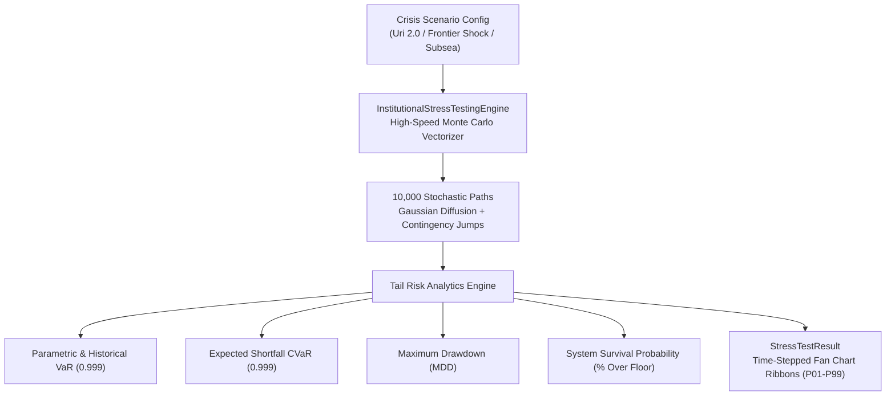

# Module Deep-Dive: `simulation`

The `simulation` module provides institutional-grade crisis stress testing, black-swan chaos engineering, and high-dimensional Monte Carlo portfolio survival evaluations.

---

## 🗺️ Simulation Engine Architecture



---

## Key Classes & Interfaces

### 1. `InstitutionalStressTestingEngine` (`simulation/stress_tester.py`)
Simulates multi-day crisis paths across coupled electrical grid and compute hardware infrastructures.

```python
from apex_compute_futures.simulation.stress_tester import (
    InstitutionalStressTestingEngine,
    StressScenarioType,
)

engine = InstitutionalStressTestingEngine(default_seed=42)

# 1. Instantiate Winter Storm Uri 2.0 ERCOT Crisis Scenario
uri_scenario = engine.create_winter_storm_uri_scenario(
    initial_capital=10_000_000.0,
    reserve_floor=2_000_000.0
)

# 2. Execute 10,000 Monte Carlo path crisis stress test
result = engine.run_stress_test(
    scenario=uri_scenario,
    num_paths=10_000,
    time_steps=48,
    confidence_level=0.999
)

print(f"Historical VaR (0.999): ${result.historical_var_999:,.2f}")
print(f"Tail CVaR (0.999):       ${result.cvar_999:,.2f}")
print(f"Max Drawdown:           {result.max_drawdown_pct:.1f}% (${result.max_drawdown_usd:,.2f})")
print(f"System Survival:        {result.system_survival_probability:.2f}%")
print(f"Runtime Latency:        {result.execution_time_ms:.2f} ms")
```

---

## Crisis Scenarios Overview

| Scenario Name | Primary Shocks | Physical / Economic Transmission Mechanism |
| :--- | :--- | :--- |
| **Winter Storm Uri 2.0** | ERCOT 59.35 Hz, $9,000/MWh LMP, 45% load shed | Extreme power costs force 45% GPU cluster shutdown; synthetic inertia AMM and battery reserves absorb frequency drop. |
| **Frontier Model Launch Shock** | -60,000 GPUs withdrawn, 85% preemption, +600 bps basis | Sudden supply withdrawal squeezes secondary spot inventory; requires emergency buy-in under wide basis spreads. |
| **Subsea Terabit Partition** | +350ms transatlantic latency, 8.5% packet loss | Transatlantic fiber cut causes routing desynchronization; triangular arbitrage orders fail; execution slippage jumps +450 bps. |

---

## Mathematical Risk Metrics

1. **Parametric Value at Risk ($\text{VaR}_{0.999}$):**
   $$\text{VaR}_{0.999} = \mu_L + z_{0.999} \cdot \sigma_L \quad (z_{0.999} \approx 3.0902)$$
2. **Parametric Expected Shortfall ($\text{CVaR}_{0.999}$):**
   $$\text{CVaR}_{0.999} = \mu_L + \sigma_L \cdot \frac{\phi(z_{0.999})}{1 - 0.999}$$
3. **Maximum Drawdown (MDD):**
   $$\text{MDD} = \max_{0 \le t \le T} \left( \frac{\text{Peak}_t - V_t}{\text{Peak}_t} \right)$$
4. **System Survival Probability:**
   $$\mathbb{P}(\text{Survival}) = \frac{1}{N} \sum_{p=1}^N \mathbf{1}_{\left\{ \min_t V_{t, p} \ge V_{\text{reserve\_floor}} \right\}}$$
